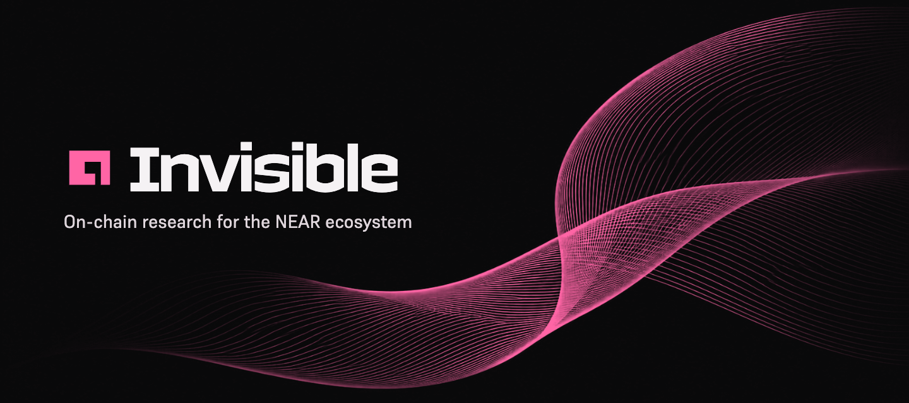
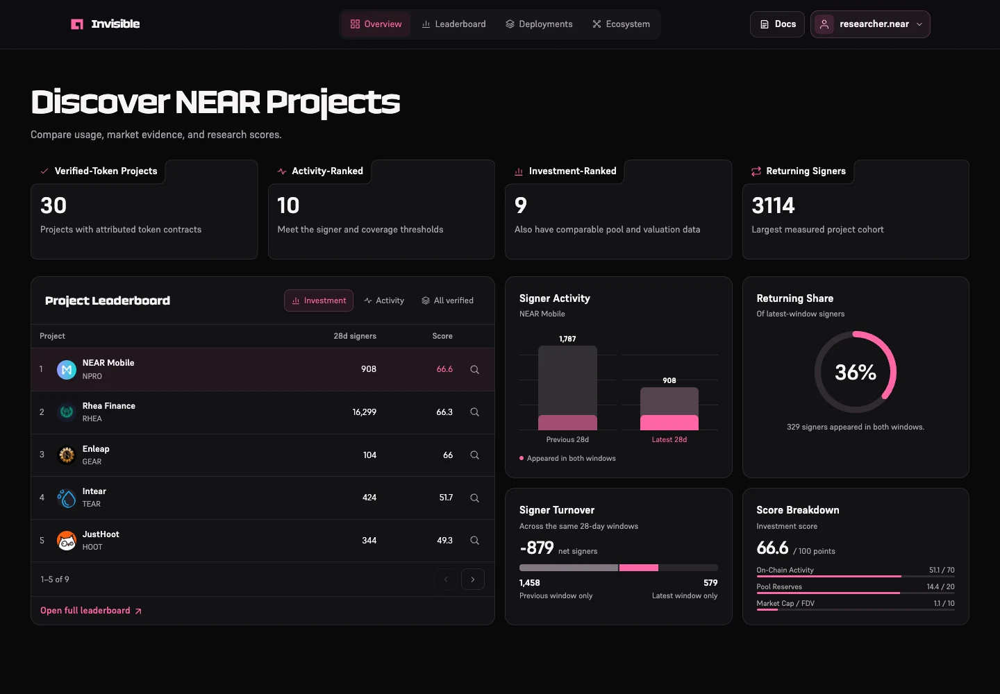
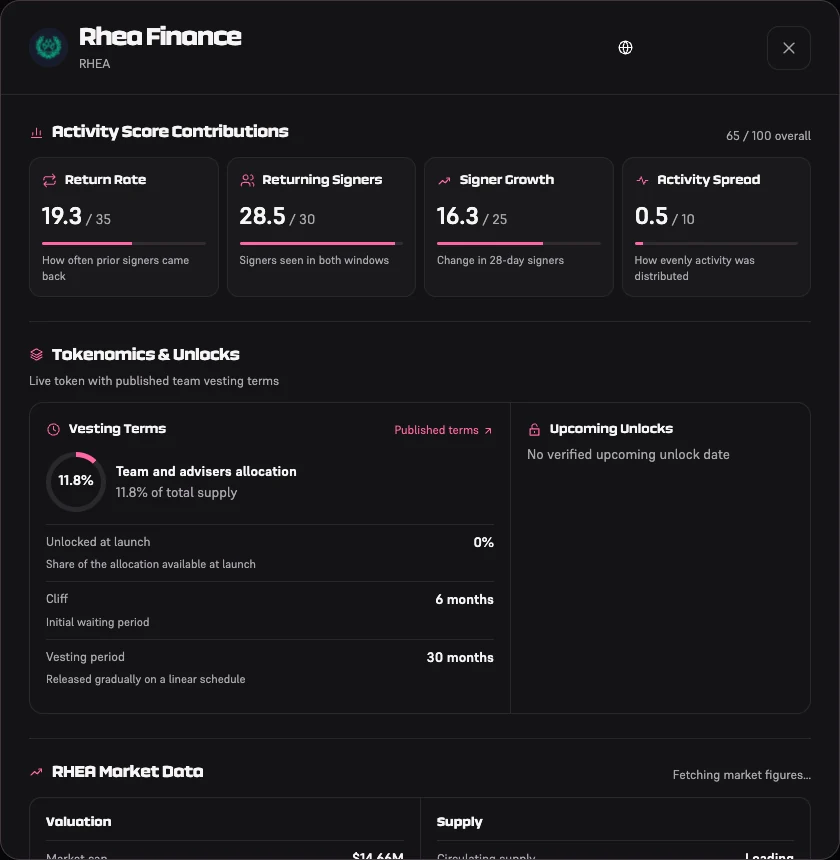
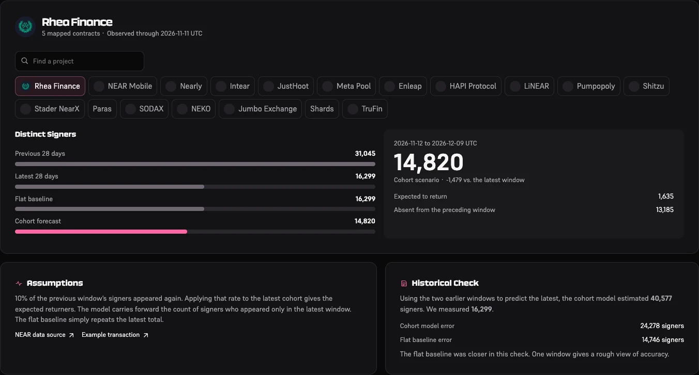
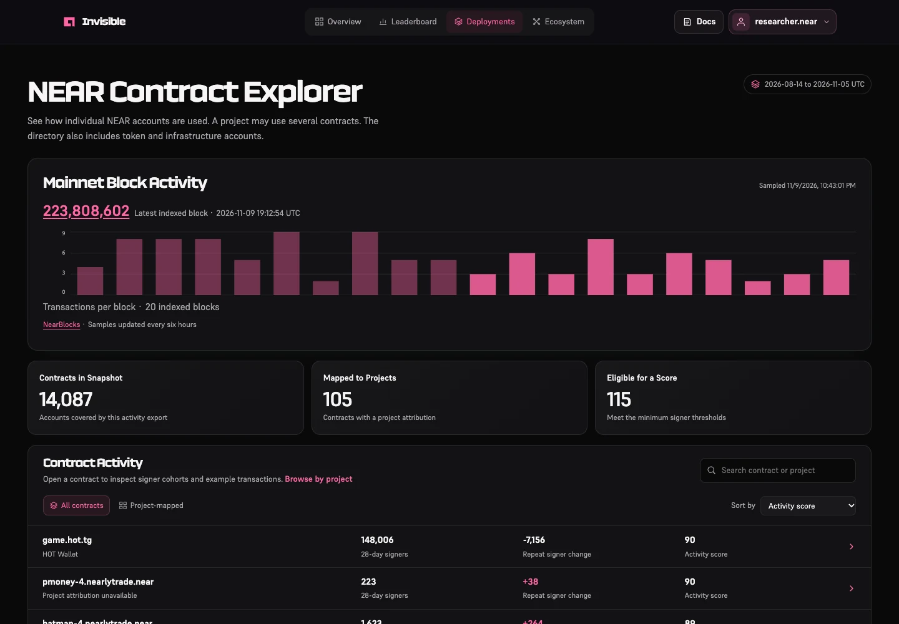
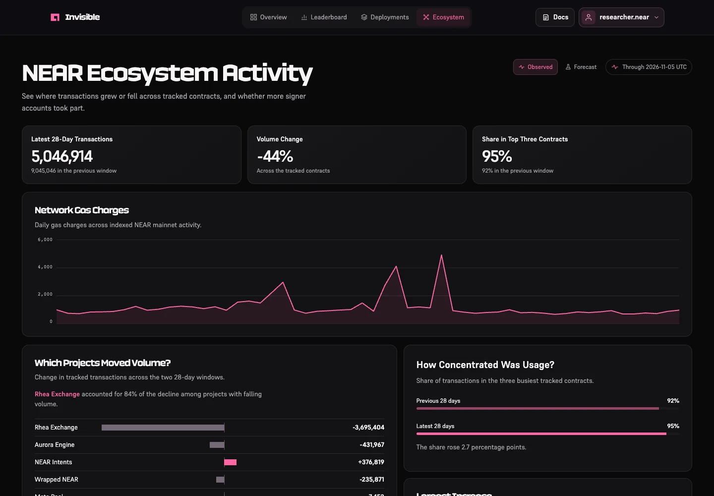
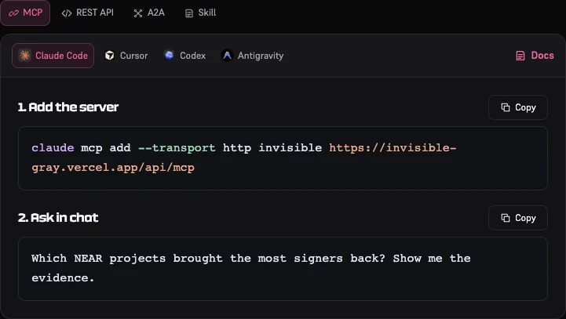
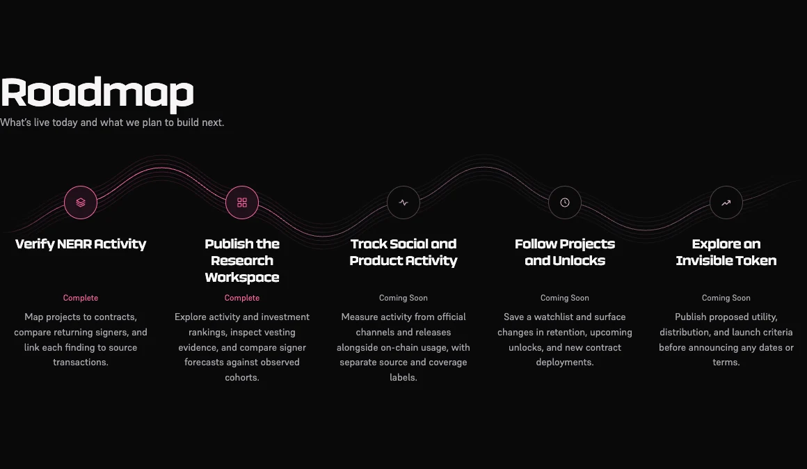

<p align="center">
  <a href="https://invisible-gray.vercel.app/">
    
  </a>
</p>

# Invisible

**Research NEAR projects from the contracts people actually use.** Invisible compares activity across two 28-day windows, shows which signing accounts came back, and links project scores to the on-chain and market evidence behind them. Analysts can inspect the dashboard, and agents can query the same research through MCP, REST, or A2A.

[Open dashboard](https://invisible-gray.vercel.app/app/) · [Read the docs](https://invisible-gray.vercel.app/docs/) · [Connect an agent](https://invisible-gray.vercel.app/#connect) · [View roadmap](https://invisible-gray.vercel.app/#roadmap)

[Features](#features) · [Methodology](#methodology) · [Agent setup](#agent-setup) · [Roadmap](#roadmap) · [Local setup](#local-setup) · [Deployment](#deployment)

---

<a href="https://invisible-gray.vercel.app/app/"></a>

## Features

| Feature | What you can do |
| --- | --- |
| [Overview](https://invisible-gray.vercel.app/app/) | Scan verified-token coverage, ranking eligibility, and the largest measured returning-signer cohort. Select a project to compare signer counts, returning share, turnover, and score contributions. |
| [Leaderboard](https://invisible-gray.vercel.app/app/discovery/) | Compare on-chain activity or switch to the investment ranking for projects with comparable market data. Open a project’s evidence to see why it qualified and which inputs affected its score. |
| [Project evidence](https://invisible-gray.vercel.app/docs/#evidence) | Inspect mapped contracts, example transactions, market source and observation date, and published tokenomics or vesting terms where available. |
| [Deployment explorer](https://invisible-gray.vercel.app/app/deployments/) | Search NEAR contract accounts or browse project mappings. Inspect example calls and measured signer cohorts alongside a saved mainnet block sample. |
| [Ecosystem](https://invisible-gray.vercel.app/app/ecosystem/) | Compare changes in signer participation and contract volume across tracked projects. Review the indexed network gas series when coverage is complete. |
| [Signer forecast](https://invisible-gray.vercel.app/app/discovery/?data=forecast) | Compare a cohort-based estimate with a flat baseline. When a third complete window exists, see how both estimates performed against observed activity. |
| [NEAR wallet access](https://invisible-gray.vercel.app/docs/#dashboard) | Connect Meteor or another supported NEAR wallet through HOT Connect and sign a message to open your profile. Copy your address, open it in NearBlocks, or disconnect from the header. |

### Inside the dashboard

| Project Evidence | Signer Forecast |
| --- | --- |
| [](https://invisible-gray.vercel.app/app/discovery/) | [](https://invisible-gray.vercel.app/app/discovery/?data=forecast) |
| Open a project from the leaderboard to see how it scored and inspect its available vesting and market data. | Compare the next-window signer estimate with a flat baseline and check how both performed on historical data. |

| Deployments | Ecosystem |
| --- | --- |
| [](https://invisible-gray.vercel.app/app/deployments/) | [](https://invisible-gray.vercel.app/app/ecosystem/) |
| Find the contracts behind a project and follow example calls to NearBlocks. | See where signer activity moved across projects and how much tracked activity is concentrated among the largest projects. |

## Methodology

Invisible counts distinct NEAR signing accounts that directly attempted a function call to a mapped product contract. A returning signer appears in both adjacent 28-day UTC windows. The same account is counted once per project per window, even if it used several of that project’s contracts. Relayers, automation, and multiple accounts affect the interpretation of signer counts.

| Ranking | Inputs |
| --- | --- |
| **Activity** | 35% adjusted return rate, 30% returning signers, 25% adjusted signer growth, and 10% activity spread across days. |
| **Investment** | 70% activity, 20% pool liquidity, and 10% market cap as a share of fully diluted valuation. Comparable market evidence is required. |

The activity leaderboard requires a verified token, 50 signers in each 28-day window, 10 in the prior weekly window, 10 returning signers, and activity on at least 14 days in the latest window. Projects outside the ranking cohort can still appear in project coverage.

The [NEAR Public Lakehouse](https://github.com/near/near-public-lakehouse) supplies indexed history, [NearBlocks](https://nearblocks.io/) supplies recent samples and transaction links, and [DEX Screener](https://dexscreener.com/near) supplies pool and valuation evidence. [Full methodology](https://invisible-gray.vercel.app/docs/#investment-methodology) · [Data sources](https://invisible-gray.vercel.app/docs/#sources)

### Reproduce the research

1. Run `npm ci` and `npm test`. The tests cover cohort eligibility, rank calculations, export safety, and NEAR wallet signature verification.
2. Fetch the [returning-signer ranking](https://invisible-gray.vercel.app/api/v1/returning-signers?limit=10). The response includes the exclusive UTC cutoff, ranked signer counts, and transaction examples. Open a row’s evidence endpoint to find the project’s mapped contracts.
3. To recompute cohorts from chain history, run [`analytics/warehouse-rankings.sql`](analytics/warehouse-rankings.sql) in the BigQuery `us-east1` location. Supply the exclusive cutoff as `@day`, the first UTC date as `@history_start`, and the project-to-contract mapping as `@registry` (a JSON array of `{ "project": "…", "contract": "…" }` records). Use 56 days of history for two windows or 84 days for the historical forecast check. [`services/warehouse-rankings.mjs`](services/warehouse-rankings.mjs) applies the eligibility thresholds and peer-percentile weights.

Repeated contract use supports a thesis of persistent NEAR application demand. It measures signing accounts within the mapped cohort. Automation, shared signers, missing contracts, and changes in attribution can affect that finding. A larger repeat cohort alone cannot establish token value capture. Compare the forecast with the flat baseline before treating it as a useful estimate.

## Agent setup

[](https://invisible-gray.vercel.app/#connect)

| Interface | Start here |
| --- | --- |
| **MCP** | Use Streamable HTTP at `https://invisible-gray.vercel.app/api/mcp`. See setup for [Claude Code, Cursor, Codex, and Antigravity](https://invisible-gray.vercel.app/docs/#mcp). |
| **REST** | Request JSON from `/api/v1/`. See the [endpoint reference and examples](https://invisible-gray.vercel.app/docs/#rest). |
| **A2A** | Read the [agent card](https://invisible-gray.vercel.app/.well-known/agent-card.json), then send a JSON-RPC `message/send` request to `/api/a2a`. See the [request example](https://invisible-gray.vercel.app/docs/#a2a). |
| **Agent skill** | Install [SKILL.md](https://invisible-gray.vercel.app/skill/SKILL.md) for guidance on researching projects and citing evidence. See the [installation instructions](https://invisible-gray.vercel.app/docs/#skill). |

<details open>
<summary><strong>Connect with MCP</strong></summary>

```sh
# Codex
codex mcp add invisible --url https://invisible-gray.vercel.app/api/mcp

# Claude Code
claude mcp add --transport http invisible https://invisible-gray.vercel.app/api/mcp
```

Try asking **“Which NEAR projects brought the most signers back? Show me the evidence.”**

- `search_projects` finds projects by name, ID, or contract.
- `get_project_evidence` reads mapped deployments, signer cohorts, and available tokenomics for a verified project ID.
- `get_rankings` reads activity, investment, or returning-signer rankings and their cutoff.

</details>

<details>
<summary><strong>Try the REST API</strong></summary>

```sh
curl -fsS 'https://invisible-gray.vercel.app/api/v1/returning-signers?limit=10'
curl -fsS 'https://invisible-gray.vercel.app/api/v1/projects/rhea'
curl -fsS 'https://invisible-gray.vercel.app/api/v1/projects/rhea/market'
```

</details>

## Roadmap

[](https://invisible-gray.vercel.app/#roadmap)

| Status | Milestone | What it covers |
| --- | --- | --- |
| Shipped | Verify NEAR Activity | Map projects to contracts, compare signer activity across two 28-day windows, and link the underlying evidence. |
| Shipped | Publish the Research Workspace | Ship the dashboard, project evidence, and agent access through MCP, REST, A2A, and the skill. |
| Coming soon | Track Social and Product Activity | Gather dated evidence from official channels and release notes. Show where it came from and compare it with on-chain activity before using it in rankings. |
| Coming soon | Follow Projects and Unlocks | Follow projects in a watchlist and surface changes in signer retention, upcoming unlocks, and new deployments. |
| Exploration | Explore an Invisible Token | Define potential utility, distribution, and launch criteria. |

## Local setup

1. Install Node.js 22 or later and npm.
2. Clone the repository and install its dependencies.

   ```sh
   git clone https://github.com/0xmugetso/invisible.git
   cd invisible
   npm ci
   npm run dev
   ```

3. Open [localhost:3000](http://localhost:3000/). The Next.js dev server serves the landing page and docs and proxies selected research requests to the public deployment. To try wallet sign-in immediately, use the [live dashboard](https://invisible-gray.vercel.app/app/).

Run `npm test` for the test suite or `npm run build` to generate the static export in `out/`.

## Deployment

The production Vercel project serves the static Next.js export and the Node functions in [`api/`](api/). See [`vercel.json`](vercel.json) for the build, routing, and cron configuration.

1. Provision PostgreSQL and set `DATABASE_URL`. Apply [`analytics/postgres.sql`](analytics/postgres.sql) and [`analytics/wallet-auth.sql`](analytics/wallet-auth.sql).
2. Set the deployment’s public origin and provider credentials using [`.env.example`](.env.example) as a reference. Keep database, cron, and provider credentials on the server.
3. Configure the research refresh below. Wallet sign-in verifies a single-use NEP-413 message against a current full-access key on NEAR mainnet and stores a database session.

### Scheduled research refresh

Use the repository root and the build settings in `vercel.json`. It deploys the static Next.js export and Node API functions. Vercel schedules one refresh in the 00:00 UTC hour. GitHub Actions schedules a second refresh at 12:17 UTC, using the repository Actions secret `INVISIBLE_REFRESH_SECRET` with the same value as Vercel’s `CRON_SECRET`. Both invoke the same authenticated endpoint.

Set `CRON_SECRET`, `DATABASE_URL`, and `BQ_PROJECT` in the production environment. Use a random cron secret. For keyless BigQuery access, follow the [Vercel Google Cloud federation guide](https://vercel.com/docs/oidc/gcp). Use the team issuer and allowed audience `https://vercel.com/TEAM_SLUG`, map `google.subject` to `assertion.sub`, and restrict the provider with `assertion.sub == 'owner:TEAM_SLUG:project:invisible:environment:production'`. Grant that exact subject Workload Identity User on the service account. The service account needs BigQuery Job User on the query project. Enable the BigQuery, Security Token Service, and IAM Service Account Credentials APIs in Google Cloud.

Set `BQ_WIF_PROVIDER` to `projects/PROJECT_NUMBER/locations/global/workloadIdentityPools/POOL_ID/providers/PROVIDER_ID` and `BQ_SERVICE_ACCOUNT_EMAIL` to the service account email. Vercel supplies a short-lived token to each cron invocation. An existing key-based setup can use `BQ_CREDENTIALS_JSON` when the federation variables are absent.

Set `NEARBLOCKS_API_KEY` for recent account samples and optionally `BQ_PROJECT_MAX_BYTES` for the ranking scan cap. The cron uses the BigQuery API.

Run the database setup before the first scheduled run. The cron finds the latest complete 56-day warehouse window with a following partition present. BigQuery computes signer cohorts across that window for mapped projects. Each summary includes the exact receiver accounts used, a signer breakdown per contract, and transaction links. PostgreSQL stores these summaries alongside the project registry. Signers are deduplicated at the project level, so per-contract totals cannot be added together. Projects without a verified token can have measured activity in Project coverage and are ineligible for either leaderboard. The cutoff advances when the next complete UTC day is available. NearBlocks supplies recent activity independently of that cutoff.

## Brand assets

[Keyhole mark](app/icon.svg) · [README banner](public/brand/readme-hero.png) · [Social banner · 1200 × 630](public/brand/social-hero.png) · [Dashboard walkthrough](public/dashboard-walkthrough.mp4)
